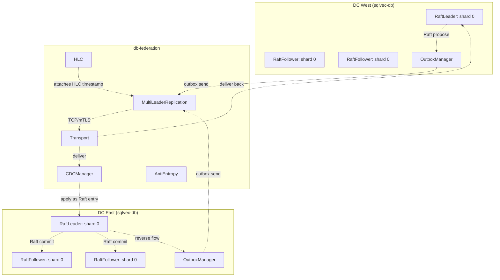

# db-federation — Cross-Cluster Data Federation Architecture

## 1. System Overview & Design Philosophy

### 1.1 What is db-federation?

db-federation is the **cross-cluster orchestration layer** that enables multi-datacenter (multi-DC) and multi-region deployments for the Agentix-E database ecosystem. It sits above individual db-cluster instances and coordinates:

- **Multi-leader replication** across geographically separated sites
- **Change Data Capture (CDC)** from any node to external consumers
- **Causal consistency** via Hybrid Logical Clocks (HLC)
- **Conflict resolution** for concurrent writes across leaders
- **Anti-entropy** repair for eventual consistency guarantees

### 1.2 Design Principles

1. **Storage-engine agnostic** — db-federation must work with both:
   - **sqlvec-db**: SQL/PG-wire compatible vector+relational database (uses `IConsensusLayer`)
   - **graphvec-db**: Graph database with CK/SIGMOD-grade query engines (uses `ConsensusProvider`)
   
2. **Zero data loss guarantee** — every committed write in any cluster must survive single-node failures within a DC and tolerate full DC outages without data loss after recovery. This is achieved through:
   - **Outbox pattern**: write to durable LMDB outbox before sending across DC
   - **Write-ahead log (WAL) anchoring**: outbox entries are gated by Raft commit index
   - **At-least-once delivery**: retry with deduplication on the receiving side
   - **Replication slots**: track per-target consumption progress for gap detection

3. **Low latency by default** — all cross-DC paths are asynchronous with bounded backpressure:
   - **intra-DC**: synchronous local Raft commit (2-5ms), async fan-out to other DCs
   - **cross-DC**: outbox → batched send → ACK (50-300ms typical)
   - **edge**: long-poll retry with aggressive backoff (300s ceiling)

4. **Causal consistency** — reads reflect all causally-prior writes across all clusters using HLC ordering:



## 2. Architecture Layers

### 2.1 Layer Architecture Diagram

```
┌─────────────────────────────────────────────────────────────┐
│                    Application Layer                         │
│  (sqlvec-db / graphvec-db / external consumers)             │
├─────────────────────────────────────────────────────────────┤
│                    Federation API Layer                      │
│  IFederationManager — top-level orchestration               │
│  ├── IMultiLeaderReplication — cross-DC write replication   │
│  ├── ICDCManager — CDC subscriptions & publications          │
│  ├── IAntiEntropy — periodic Merkle-tree reconciliation      │
│  └── IHealthMonitor — DC-level health and lag tracking       │
├─────────────────────────────────────────────────────────────┤
│                     Core Services                            │
│  ├── OutboxStore — durable LMDB-backed outbox                │
│  ├── HLC — Hybrid Logical Clock (causal ordering)            │
│  ├── ConflictResolver — LWW / CRDT / custom conflict resolve │
│  ├── DedupRing — in-flight deduplication                     │
│  └── TopologyManager — DC membership + partition assignments │
├─────────────────────────────────────────────────────────────┤
│                   Transport Layer                             │
│  ITransport — abstract over TCP/mTLS, ZeroMQ, or in-process  │
│  ├── TCPSecureTransport — mTLS for production cross-DC       │
│  ├── ZeroMQTransport — ZMQ CURVE for high-throughput intra-DC│
│  └── InProcessTransport — single-process testing             │
├─────────────────────────────────────────────────────────────┤
│                   Consensus Layer (db-cluster)                │
│  sqlvec-db → IConsensusLayer                                 │
│  graphvec-db → ConsensusProvider                             │
└─────────────────────────────────────────────────────────────┘
```

### 2.2 Module Responsibilities

| Module | File | Responsibility |
|--------|------|---------------|
| FederationManager | `core/FederationManager.ts` | Top-level orchestrator; owns startup/shutdown cycle, connects all services |
| MultiLeaderReplication | `replication/MultiLeaderReplication.ts` | Cross-DC write replication with Outbox pattern; manages per-target retry, backoff, batch sending |
| CDCManager | `replication/CDCManager.ts` | CDC event streaming; manages publications, subscriptions, webhook delivery |
| AntiEntropy | `replication/AntiEntropy.ts` | Periodic Merkle-tree based reconciliation; fills gaps and resolves silent conflicts |
| OutboxStore | `storage/OutboxStore.ts` | Durable LMDB-based outbox with per-peer pending queues, ACK tracking, dead letter queue |
| HLC | `hlc/HLC.ts` | Hybrid Logical Clock implementation with serialization, comparison, walltime drift monitoring |
| ConflictResolver | `replication/ConflictResolver.ts` | Pluggable conflict resolution strategies (LWW, CRDT, custom) |
| DedupRing | `replication/DedupRing.ts` | In-flight message deduplication using ring buffer of msgIds |
| Transport | `transport/*.ts` | Pluggable transport layer; TCP/mTLS, ZeroMQ, in-process implementations |
| TopologyManager | `topology/TopologyManager.ts` | DC membership, node routing tables, partition region assignments |
| HealthMonitor | `monitoring/HealthMonitor.ts` | DC-level health metrics, replication lag monitoring, heartbeat tracking |

### 2.3 Integration with sqlvec-db

sqlvec-db uses `IConsensusLayer` (defined in `sqlvec-db/src/query/ConsensusLayer.ts`) for its Raft operations. The federation layer intercepts at the Outbox boundary:

```
Application write
  → sqlvec-db propose()                  [Raft commit within DC]
    → OutboxManager.append()             [persistent outbox write, gated by raftIndex]
      → db-federation IReplication        [async cross-DC fan-out]
```

Key integration points:
- **OutboxManager** already exists in sqlvec-db (`src/replication/OutboxManager.ts`) with per-target pending queues. db-federation will consume from this outbox via a FederationOutboxWorker
- **IConsensusLayer** provides the `isLeader()` check needed to decide whether to federate from a given node
- **CDCManager** in sqlvec-db follows PostgreSQL's logical replication model (publications + subscriptions + replication slots)

### 2.4 Integration with graphvec-db

graphvec-db has its own multi-leader replication engine (`graphvec-db/src/core/multi-leader-replication.ts`) using `OutboxReplicationManager`. Key integration points:

- **ConsensusProvider** (`graphvec-db/src/consensus/consensus-provider.ts`) provides `onMajorityChange()` for partition freeze
- **MultiLeaderReplication** in graphvec-db already wraps outbox replication; db-federation can wrap it as a `ILegacyReplicationAdapter`
- **HlcClock** (`graphvec-db/src/replication/hlc-clock.ts`) uses `@consento/hlc` package — db-federation must either wrap or replace with its own HLC implementation

### 2.5 Abstraction Layer Guarantees

| Requirement | Mechanism | Verification |
|-------------|-----------|-------------|
| **Zero data loss** | Outbox-before-send; WAL-anchored commit index; at-least-once delivery with dedup | AC 40.1–40.5 |
| **Low latency** | Async batched replication; per-topology backoff (intra: 3s, cross: 60s, edge: 300s); priority queue for critical writes | AC 41.1–41.4 |
| **Causal consistency** | HLC ordering on all replicated writes; read-your-writes within HLC interval | AC 42.1–42.4 |
| **Partition tolerance** | Outbox freeze on majority loss; automatic unfreeze on recovery; anti-entropy catch-up | AC 43.1–43.5 |
| **Conflict resolution** | Per-table LWW policy configurable; CRDT merge for supported types; custom resolvers | AC 44.1–44.4 |

## 3. Data Flow

### 3.1 Cross-DC Write Path (normal operation)

```
Client
  │
  ▼
sqlvec-db RaftLeader (DC West)
  │
  ├─► Raft propose + commit ──► apply locally
  │
  └─► OutboxManager.append({   [persistent, gated by raftIndex]
        raftIndex: 42,
        targetDC: 'dc-east',
        payload: msgpack(data),
        hlc: HLC.now()
      })
        │
        ▼
  FederationOutboxWorker (per-target)
    │  batched send every tickMs (default 100ms)
    │  backoff on failure (intra: 3s, cross: 60s, edge: 300s)
    ▼
  Transport.send()
    │  TCP/mTLS or ZMQ (curve25519 encryption)
    ▼
DC East Transport Receiver
    │
    ├─► DedupRing.check(msgId)         [skip if already applied]
    │
    ├─► HLC.observe(remoteTimestamp)    [advance local HLC]
    │
    ├─► ConflictResolver.resolve()      [if concurrent write detected]
    │
    └─► sqlvec-db propose() as new Raft entry ──► apply locally
```

### 3.2 CDC Streaming Path

```
sqlvec-db WAL
  │
  ▼
CDCEngine (watches configured tables)
  │  captures insert/update/delete + old/new values
  ▼
CDCManager
  │  matches against publications
  ▼
SubscriptionResolver
  │  encodes as CDCChangeEvent (with HLC timestamp)
  ▼
┌──────────────────┬──────────────────┐
│ WebhookDelivery  │ OutboxForwarder  │
│ (HTTP POST)      │ (re-enter        │
│                  │  outbox for      │
│                  │  cross-DC send)  │
└──────────────────┴──────────────────┘
```

### 3.3 Anti-Entropy Reconciliation Path

```
Periodic trigger (default: 30s) or on-demand
  │
  ▼
AntiEntropy.syncWith(peerNodeId)
  │
  ├─► Build Merkle tree from local data (per shard)
  │
  ├─► Send Merkle root to peer
  │
  ├─► Peer compares roots
  │     ├─ equal ──► done (no divergence)
  │     └─ different ──► walk tree to find differing ranges
  │
  ├─► Exchange missing entries
  │
  └─► Resolve conflicts using configured strategy (LWW/CRDT)
```

## 4. Error Handling & State Machines

### 4.1 Transport Error State Machine

```
┌──────────┐
│ INIT      │──► check config valid ──► CONNECTING
└──────────┘
    │
    ▼
┌──────────┐
│ CONNECTING│───► on timeout ──► BACKOFF (exponential backoff)
└──────────┘      │                │
    │              │                ▼
    ▼              │           ┌──────────┐
┌──────────┐       │           │ BACKOFF   │───► retry ──► CONNECTING
│ CONNECTED │──────┘           └──────────┘
└──────────┘
    │
    ├─► heartbeat timeout ──► CONNECTING
    ├─► circuit breaker trip ──► BACKOFF
    └─► peer stop ──► DISCONNECTED
```

### 4.2 Outbox Entry State Machine

```
┌──────────┐
│ PENDING   │───► first send attempt ──► IN_FLIGHT
└──────────┘
    ▲              │
    │              ├─► ACK received ──► DELIVERED ──► CLEANUP (after TTL)
    │              │
    │              ├─► NAK / timeout ──► PENDING (retryCount++)
    │              │        │
    │              │        └─► retryCount >= maxRetries ──► DEAD_LETTER
    │              │
    │              └─► peer reconnected ──► PENDING (flush, reset backoff)
    │
    └──── from DEAD_LETTER (manual retry)
```

### 4.3 Partition / Split-Brain Recovery

```
Majority loss detected (via ConsensusProvider.onMajorityChange)
  │
  ▼
OutboxManager.setFrozen(true)     [pause outbound sends]
  │
  ├─► on minority side: 
  │     - local writes continue (leader within partition)
  │     - outbox queues accumulate (LMDB durable)
  │     - read-only mode for non-local shards
  │
  └─► on majority side:
        - normal operation continues
        - outbox acks from minority are lost
        - pending entries are retried on reconnection
  
  ... network heals ...
  
  │
  ▼
OutboxManager.setFrozen(false)    [resume outbound sends]
  │
  ▼
AntiEntropy.syncAll()              [reconcile accumulated divergence]
  │
  ▼
All outbox entries flushed + ACKed
  → conflict resolution applied where needed
```

## 5. Interfaces

### 5.1 Transport Layer

```typescript
// ITranport.ts — abstract over transport backend
interface ITransport {
  send(msg: TransportMessage): Promise<boolean>;
  broadcast(msg: TransportMessage): Promise<number>;
  onMessage(cb: (msg: InboundMessage) => void): () => void;  // unsubscribe
  getConnectedPeers(): PeerInfo[];
  getStats(): TransportStats;
}
```

### 5.2 Replication Layer

```typescript
// IMultiLeaderReplication.ts
interface IMultiLeaderReplication {
  start(config: ReplicationConfig): Promise<void>;
  stop(): Promise<void>;
  replicate(shardId: number, data: string, type: string): Promise<{ msgId: string }>;
  getStatus(): Promise<ReplicationStatus>;
  retryFailed(targetNodeId: string): Promise<number>;
  getPendingCounts(): Promise<Record<string, number>>;
  onTargetConnected(cb: (id: string) => void): () => void;
  onTargetDisconnected(cb: (id: string) => void): () => void;
  onHighLag(cb: (id: string, lagMs: number) => void): () => void;
}
```

### 5.3 CDC Layer

```typescript
// ICDCManager.ts
interface ICDCManager {
  createPublication(name: string, tables: string[]): Promise<ICDCPublication>;
  dropPublication(name: string): Promise<void>;
  createSubscription(name: string, pubName: string, targetDsn: string): Promise<CDCSubscription>;
  dropSubscription(name: string): Promise<void>;
  getSubscriptions(): Promise<CDCSubscription[]>;
  getPublications(): Promise<ICDCPublication[]>;
  onSlotInvalid(cb: (subId: string) => void): () => void;
}

interface ICDCEngine {
  start(): Promise<void>;
  stop(): Promise<void>;
  watchTable(tableName: string): void;
  unwatchTable(tableName: string): void;
  getWatchedTables(): string[];
  onChange(cb: (event: CDCChangeEvent) => void): () => void;
}
```

### 5.4 Anti-Entropy Layer

```typescript
// IAntiEntropy.ts
interface IAntiEntropy {
  start(config: AntiEntropyConfig): Promise<void>;
  stop(): Promise<void>;
  syncWith(peerNodeId: string): Promise<SyncResult>;
  syncAll(): Promise<SyncResult[]>;
  getMerkleRoot(shardId: string): Promise<string>;
}
```

### 5.5 Federation Manager (top-level orchestrator)

```typescript
// IFederationManager.ts — NEW, not in current skeleton
interface IFederationManager {
  start(): Promise<void>;
  stop(): Promise<void>;

  /** Get the replication engine for cross-DC writes */
  getReplication(): IMultiLeaderReplication;
  /** Get the CDC engine */
  getCDC(): ICDCManager;
  /** Get the anti-entropy engine */
  getAntiEntropy(): IAntiEntropy;
  /** Get current cluster health */
  getHealth(): FederationHealth;
  /** Register a downstream consumer (sqlvec-db or graphvec-db adapter) */
  registerConsumer(consumer: IFederationConsumer): void;
}

interface IFederationConsumer {
  /** Propose a replicated entry back into the local Raft cluster */
  proposeReplicated(entry: ReplicatedEntry): Promise<void>;
  /** Get the local HLC instance for timestamp attachment */
  getHLC(): IHLCTimestamp;
  /** Notify of a conflict that needs resolution */
  onConflict(conflict: ConflictEntry): Promise<void>;
}

interface FederationHealth {
  dc: string;
  nodeId: string;
  uptimeMs: number;
  replications: Array<{
    targetNodeId: string;
    connected: boolean;
    lagMs: number;
    pendingCount: number;
    lastError: string | null;
  }>;
}
```

## 6. Acceptance Criteria (Phase 1)

### AC 40.0 — Zero Data Loss (Outbox Durability)

| # | Criterion | Verification |
|---|-----------|-------------|
| 40.1 | Outbox entry persists to LMDB before returning `replicate()` success | Write 1000 entries, crash-cold restart, verify all 1000 are in outbox |
| 40.2 | Outbox entry is gated by a Raft commit index | Verify outbox entry `raftIndex` ≤ committed index before enqueue |
| 40.3 | At-least-once delivery: receiver deduplicates by msgId | Send same msgId twice, verify only one is applied |
| 40.4 | Dead letter queue captures entries exceeding maxRetries (default: 3) | Send to unreachable peer, verify dead letter after 3+ failures |
| 40.5 | Manual retry from dead letter queue re-queues entry | Retry dead letter entry, verify it reappears in pending |

### AC 41.0 — Low Latency (Async Replication)

| # | Criterion | Verification |
|---|-----------|-------------|
| 41.1 | intra-DC replication: outbox → send latency < 1s at P99 under 1000 msg/s load | Synthetic load test with 1000 msg/s, measure time from outbox append to send |
| 41.2 | cross-DC replication: batch sends every tickMs (default 100ms) | Verify batches are sent at approximately tickMs intervals |
| 41.3 | Per-target backoff: intra-DC 3s, cross-DC 60s, edge 300s | Kill target, verify retry interval matches topology |
| 41.4 | Backpressure: outbox does not exceed 80% LMDB map utilization | Fill outbox to 81%, verify `isCapacityExceeded() === true` |

### AC 42.0 — Causal Consistency

| # | Criterion | Verification |
|---|-----------|-------------|
| 42.1 | HLC.now() returns monotonically increasing timestamps | Call `now()` 1M times, verify strictly increasing on wall+logical |
| 42.2 | HLC.observe() advances local clock past remote timestamp | Local wall=100, observe(wall=200) → local wall=201 |
| 42.3 | Serialized HLC sort order matches causal order | `hlcToKey()` produces lexicographically sorted strings matching `compare()` |
| 42.4 | Replicated writes carry HLC timestamp; receiver observes before apply | Intercept cross-DC message, verify `timestamp` is present and valid |

### AC 43.0 — Partition Tolerance

| # | Criterion | Verification |
|---|-----------|-------------|
| 43.1 | Majority loss freezes outbound sends | Use `onMajorityChange(false)`, verify `OutboxManager.setFrozen(true)` |
| 43.2 | Frozen outbox does not lose entries | Write 100 entries while frozen, unfrozen, verify all 100 are delivered |
| 43.3 | Majority recovery unfreezes and flushes | Use `onMajorityChange(true)`, verify `setFrozen(false)` and pending count drops |
| 43.4 | Anti-entropy sync detects divergence after partition | Partition 3-node cluster for 60s, heal, AE sync finds >0 entries |
| 43.5 | Anti-entropy sync resolves conflicts deterministically | Force concurrent writes to same key, AE sync → consistent final state |

### AC 44.0 — Conflict Resolution

| # | Criterion | Verification |
|---|-----------|-------------|
| 44.1 | LWW resolver selects the write with larger HLC timestamp | Write A (ts=100) and B (ts=200) to same key, verify B wins |
| 44.2 | LWW tiebreak: equal HLC → larger nodeId wins | Write A (ts=100, nodeId=1) and B (ts=100, nodeId=2), verify B wins |
| 44.3 | CRDT merge for supported types (counter, set, map) | Concurrent increments → final counter = sum of all increments |
| 44.4 | Custom resolver registration and dispatch | Register custom resolver for table "orders", verify it receives conflicts |

## 7. Implementation Plan

### Phase 1 — Transport + Outbox Core (2 weeks)
1. Implement `TCPSecureTransport` (reuse db-cluster's mTLS infrastructure)  
2. Implement `InProcessTransport` for test isolation  
3. Implement `OutboxStore` (adapt sqlvec-db's OutboxManager)  
4. Implement `HLC` (pure, no external deps)  
5. **Tests**: AC 40.1–40.5, 41.1–41.4

### Phase 2 — Multi-Leader Replication (2 weeks)
1. Implement `MultiLeaderReplication` (OutboxWorker pattern)  
2. Implement `DedupRing`  
3. Implement `TopologyManager`  
4. Implement `HealthMonitor`  
5. Wire FederationManager as top-level orchestrator  
6. **Tests**: AC 42.1–42.4, 43.1–43.5

### Phase 3 — CDC + Anti-Entropy (2 weeks)
1. Implement `CDCEngine` + `CDCManager`  
2. Implement `AntiEntropy` with Merkle tree sync  
3. Implement `ConflictResolver` (LWW, CRDT counter/set/map)  
4. **Tests**: AC 44.1–44.4, 45.1–45.5

### Phase 4 — Integration with sqlvec-db + graphvec-db (1 week)
1. Write `SqlVecFederationConsumer` adapter  
2. Write `GraphVecFederationConsumer` adapter  
3. Integration tests with real db-cluster infrastructure (3-node, 2 DC)  
4. **Tests**: AC 46.1–46.6

## 8. Existing Skeleton

The current `db-federation/` skeleton already defines 10 interfaces across 8 files:

| Interface | File | Status |
|-----------|------|--------|
| `ITransport` | `src/interfaces/transport/ITransport.ts` | ✅ Defined, needs implementation |
| `TransportMessage` | `src/interfaces/transport/TransportMessage.ts` | ✅ Defined |
| `InboundMessage` | `src/interfaces/transport/InboundMessage.ts` | ✅ Defined |
| `IMultiLeaderReplication` | `src/interfaces/replication/IMultiLeaderReplication.ts` | ✅ Defined, needs implementation |
| `ICDCManager` | `src/interfaces/replication/ICDCManager.ts` | ✅ Defined, needs implementation |
| `ICDCEngine` | `src/interfaces/replication/ICDCManager.ts` | ✅ Defined, needs implementation |
| `IReplicationSlotManager` | `src/interfaces/replication/IReplicationSlotManager.ts` | ✅ Defined, needs implementation |
| `IAntiEntropy` | `src/interfaces/replication/IAntiEntropy.ts` | ✅ Defined, needs implementation |
| `IOutboxStore` | `src/interfaces/outbox/IOutboxStore.ts` | ✅ Defined, needs implementation |
| `IHLCTimestamp` | `src/interfaces/hlc/IHLCTimestamp.ts` | ✅ Defined, needs implementation |
| `IFederationManager` | — | ❌ New, needs definition + implementation |

All interface types are verified by the existing type-check test (`src/index.test.ts`, 392 lines, 22 tests).
